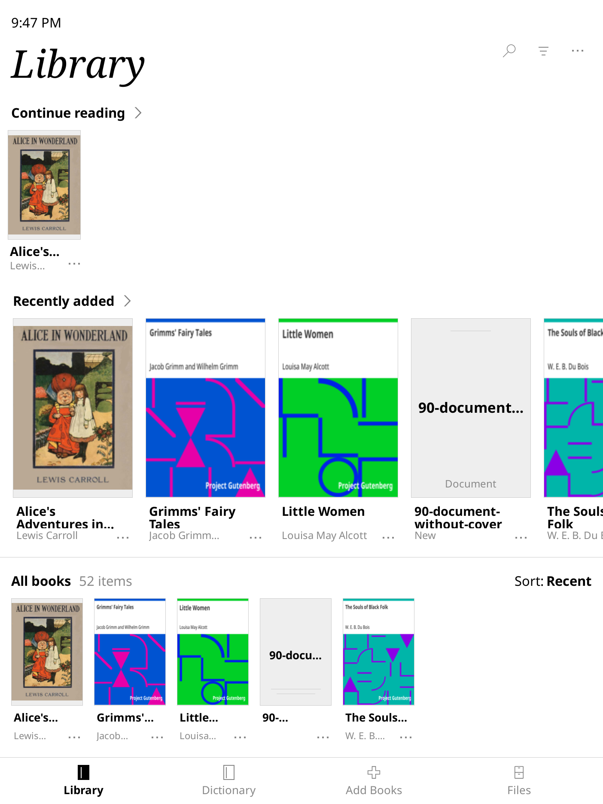

# KOReader Bookshelf


<p>
  
  
</p>

KOReader Bookshelf is an experimental, opt-in prototype that brings a modern reading and library dashboard to Remarkable devices.

### For Users: A Modern Library Experience
We believe that e-ink devices should feel like paper, not file systems. The Bookshelf provides a high-performance alternative to the standard folder view:
- **Visual Grid:** Fast-loading book covers on a clean, distraction-free surface.
- **Native Feeling:** Seamless integration with your existing KOReader setup.
- **Opt-In Safety:** Your file manager is always one tap away.


### Quick Start
Install the prototype and explore the future of the KOReader UI:
```bash
sh -c "$(curl -fsSL https://raw.githubusercontent.com/zane/koreader-bookshelf/main/tools/install.sh)"
```

## Repository Layout

- `bookshelf.koplugin/`: KOReader plugin code for the Library surface.
- `integration/koreader/`: KOReader core integration files that are still best
  carried in a fork until a clean upstream hook exists.
- `spec/unit/`: unit tests for provider behavior, Home routing, and measurement
  helpers.
- `tools/`: measurement tooling for repeatable performance notes.
- `doc/`: manual QA, emulator notes, and evidence format.

## Design and QA Docs

- `doc/Bookshelf_design_spec.md`: library surface layout, typography, icon, and
  spacing spec.
- `doc/Reading_preset_visual_qa.md`: reading preset glossary, visual fixture
  matrix, and screenshot review schema.
- `doc/Bookshelf_prototype_measurement.md`: emulator setup, manual QA notes, and
  performance evidence format.

## Local Development

This repo is developed against a KOReader checkout. The Lua code runs inside KOReader's own environment; host-global Lua is not required.

The source-of-truth boundary is executable. Edit `bookshelf.koplugin/` in this
repo, then apply it to the local KOReader checkout and validate the mirror:

```sh
export KOREADER_CHECKOUT=/path/to/koreader
python3 tools/apply_to_koreader_checkout.py
python3 tools/validate_bookshelf_manifest.py --strict
```

The validator must exit `0` before a local preview is trusted. To launch the
repo-owned noVNC preview at reMarkable dimensions:

```sh
tools/preview.sh --checkout "$KOREADER_CHECKOUT" --port 6081
```

Then open `http://localhost:6081/vnc.html?autoconnect=true&resize=scale`.
The wrapper applies the plugin mirror, validates it, seeds a sample library,
resets the preview profile, and starts a disposable container.

## Verification

The current verification target is:

- Lua loads for the plugin and integration launcher.
- Busted specs for provider and Home routing behavior.
- Python unit tests for `tools/bookshelf_measure.py` and
  `tools/reading_preset_qa.py`.
- Manual visual QA in the SDL/noVNC emulator at reMarkable dimensions.
- Performance samples recorded through `tools/bookshelf_measure.py`.
- Promoted reading-preset capture records validated through
  `tools/reading_preset_qa.py`.

Measurement helper examples:

```sh
python3 tools/bookshelf_measure.py scenarios
python3 tools/bookshelf_measure.py repeat \
  --iterations 10 \
  --device remarkable2 \
  --scenario first_visible_paint \
  --cache-state warm \
  --library-size 250
python3 tools/bookshelf_measure.py summarize
```

Reading-preset capture validation:

```sh
python3 tools/reading_preset_qa.py validate \
  --captures doc/captures \
  --require-captures
```

## License

KOReader is licensed under the GNU Affero General Public License. This prototype keeps the same license; see `COPYING`.
